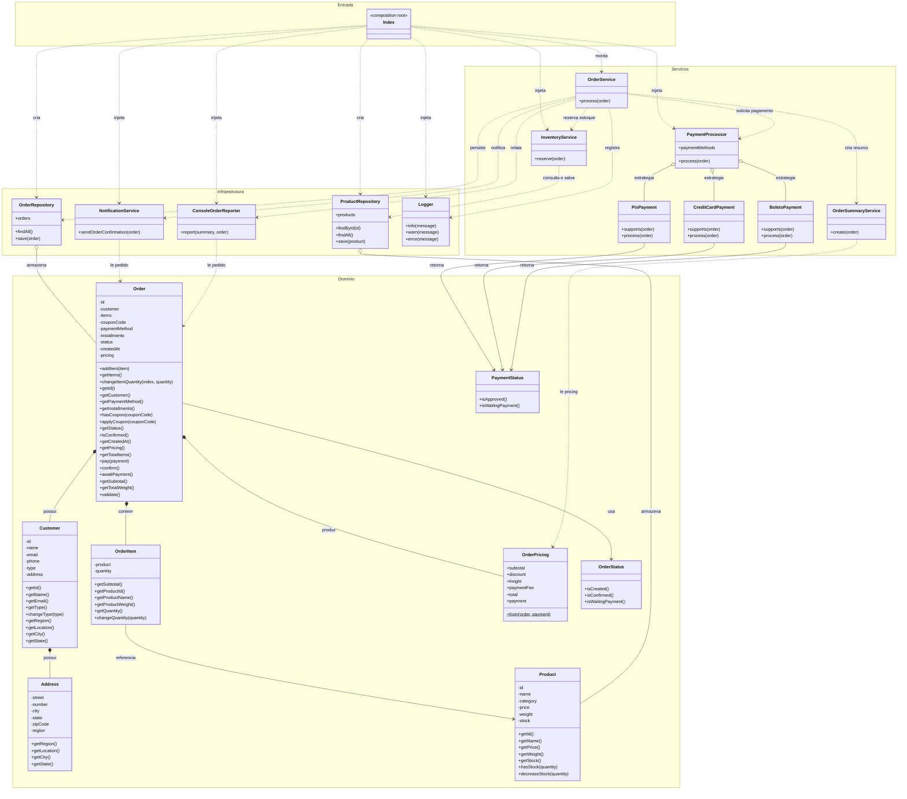

# Diagrama de Classes Atual

O diagrama abaixo representa a arquitetura refatorada. `repositories` e `infrastructure` pertencem à mesma camada de infraestrutura; o domínio concentra entidades, estados e pricing; e `OrderService` coordena os serviços especializados. Os atributos com `-` são campos privados das entidades. Os contratos das dependências são implícitos, seguindo o duck typing do JavaScript.

