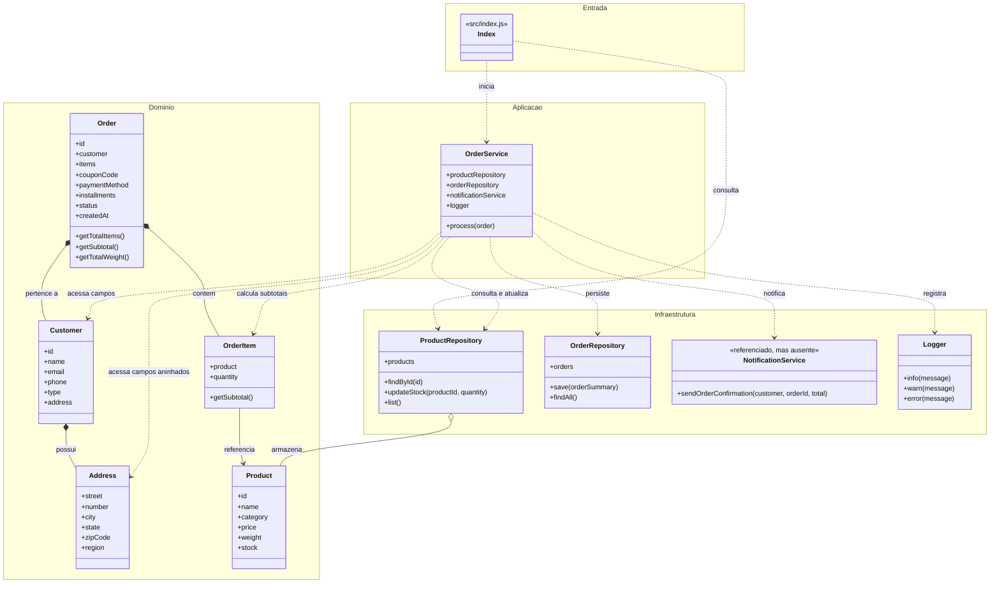

# Diagrama de Classes Original

Este diagrama representa a estrutura antes da refatoração. O `OrderService` concentrava validação, cálculo de preços, pagamento, estoque, persistência, notificação e saída em console.

